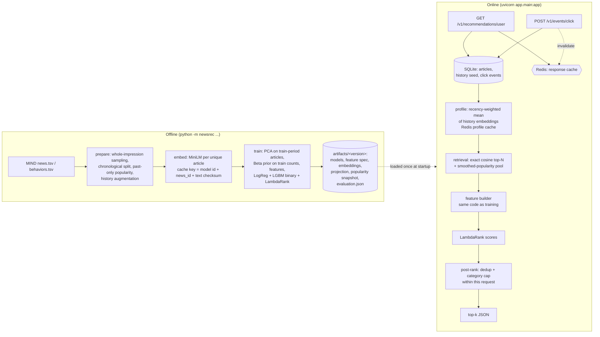

# Editorial Intelligence Engine: MIND news recommender

A locally runnable news recommendation project built on the **Microsoft MIND** dataset. It has two parts:

* **Offline pipeline (`newsrec/`).** Group-preserving sampling, a chronological train/val/test split, point-in-time (past-only) popularity features, MiniLM title embeddings, user-history profiles, and three separately defined models: a Logistic Regression CTR baseline, a LightGBM CTR classifier and a LightGBM LambdaRank ranker. It also runs baselines, ablations and bootstrap confidence intervals.
* **REST service (`app/`).** FastAPI + Redis + SQLite. It retrieves candidates from the catalogue, ranks them with the saved LambdaRank model, applies diversity/dedup constraints and caches profiles and responses. Click events are stored idempotently and invalidate the user's cached results.

> **Evaluation & Data Note:** The Microsoft MIND dataset files are not tracked in this repository due to size constraints. The baseline metrics below are generated on synthetic verification data (`python -m newsrec demo`) for pipeline verification. For complete evaluation on the official dataset, see [Run on real MIND](#run-on-real-mind).

---

## 1. Problem and use case

Given a user's click history, return the top-*k* news articles they are most likely to click. Offline, the
task is learned from MIND impression logs: each log is a slate of displayed articles with click labels.
Online, the service has to *form* a candidate set itself, because there is no MIND slate at request time.
It then ranks that candidate set.

## 2. Architecture



**Retrieval → ranking → post-ranking are three separate steps.**
1. *Retrieval* (`newsrec/retrieval/retriever.py`) narrows the catalogue to about 200 candidates. It takes the top-N by cosine similarity to the user's profile vector, plus a pool of articles with high smoothed past CTR. Already-seen articles are excluded and duplicates removed. Cold-start users get only the popularity pool.
2. *Ranking*: the LambdaRank model scores those candidates (`app/services/recommender.py`).
3. *Post-ranking* (`newsrec/postrank.py`) applies near-duplicate removal (cosine ≥ 0.9) and an optional per-category cap. Scores are compared **only within the current request**.

This is **not** a two-tower model. The user vector is a deterministic recency-weighted average, not a trained user tower.

## 3. MIND data and label semantics

* `behaviors.tsv`: impression id, user id, time (`MM/DD/YYYY HH:MM:SS AM/PM`), history (clicked news ids, documented as *ordered by time*; the last element is treated as most recent) and impressions (`N123-1 N456-0`, order shuffled by MIND, so **no display positions**).
* `news.tsv`: id, category, subcategory, title, abstract, url, entities.
* Label: `1` = displayed and clicked; `0` = displayed and not clicked. Articles that were never displayed are never treated as negatives. Malformed or unlabeled tokens raise an error instead of being skipped silently.

## 4. Features (one schema for training and serving)

The schema lives in `newsrec/features/schema.py`. Every feature records its meaning, when it is computed, its source, its default and its leakage status. Its order and fingerprint are saved with the models, and loading fails if they don't match. Default dimensionality: **10 base features + 32 PCA components = 42**.

| Group | Features | Notes |
|---|---|---|
| popularity | `past_impressions_log1p`, `past_clicks_log1p`, `past_ctr_smoothed` | Uses only impressions **strictly before** the impression time. Same-timestamp impressions never see each other. Smoothed CTR = (c+α)/(n+α+β), with the Beta prior fitted on **training-period** counts only. |
| freshness | `hours_since_first_seen_log1p` | Age since the article's first exposure in the log. This is an exposure-age **proxy**: MIND has no publish time. |
| profile | `history_length_log1p`, `profile_cosine`, `profile_max_cosine`, `category_affinity`, `subcategory_affinity` | Built from MiniLM vectors of prior clicks. `user_id` is never a feature. |
| content | `title_word_count` | |
| embedding | `emb_pca_0..31` | PCA fitted on training-period article vectors and persisted. The `full` mode (384 dims) and `none` mode are also available. |

The exploratory features in `feature_engineering.py` (sentiment, NER, readability, clickbait) are **not** used by any model.

## 5. Models and why each exists

| Model | Objective | Output | Used for |
|---|---|---|---|
| `all-MiniLM-L6-v2` (frozen) | none (pretrained, no fine-tuning) | 384-d L2-normalized title vector | content representation, profiles, retrieval |
| Logistic Regression (impute → scale → L2 LR, no class weights) | log-loss | **uncalibrated** click probability | interpretable CTR baseline |
| LightGBM `objective=binary` | log-loss, early-stopped on validation | **uncalibrated** click probability | CTR estimate (`include_ctr=true` in the API) |
| LightGBM `objective=lambdarank` | ΔNDCG-weighted pairwise loss, early-stopped on validation NDCG@5 | **raw ranking score**: comparable only within a slate or request | ranking in the API |

Probabilities and ranking scores have distinct types in code (`ClickProbabilities` vs `RankingScores`), so probability metrics refuse ranking scores. No calibration model is fitted. ECE and reliability tables are reported only as diagnostics.

## 6. Evaluation protocol and leakage prevention

* **Group-preserving sampling.** Whole impressions are sampled. A candidate-row budget never truncates a slate.
* **Chronological split** by timestamp: train < `val_start` ≤ val < `test_start` ≤ test (ties go to the later split). Validation is used only for early stopping. Reported results come from the untouched test period over **complete slates**.
* **Point-in-time features.** Popularity and history augmentation only use events strictly before the impression. Leakage tests check this by flipping current, same-time and future labels: features must not change. Reintroducing the old whole-sample `global_ctr` makes 10 tests fail.
* **Metric conventions.** NDCG@5/10, MRR and Recall@10 are computed per impression and averaged over impressions with ≥1 click. The share of no-click impressions is reported separately. Ties are broken by a seeded random permutation. 95% bootstrap confidence intervals are taken over impressions.
* **Baselines:** random (seeded) and past-popularity. **Ablations:** popularity-only, content-only, and full minus profile features.

### Results: SYNTHETIC smoke test only (not MIND)

Run: `python -m newsrec demo` (hashing test encoder, 2,500 synthetic impressions). Test period: 500 impressions, 6,968 candidates, positive rate 0.132, no-click share 0.18 (410 impressions evaluated).

| Ranker (test) | NDCG@5 | NDCG@10 [95% CI] | MRR | Recall@10 |
|---|---|---|---|---|
| random | 0.272 | 0.409 [0.386, 0.436] | 0.352 | 0.727 |
| past popularity | 0.478 | 0.580 [0.556, 0.606] | 0.552 | 0.850 |
| LambdaRank (full) | 0.572 | 0.667 [0.642, 0.691] | 0.664 | 0.893 |
| LambdaRank popularity-only | 0.442 | 0.556 [0.529, 0.579] | 0.515 | 0.843 |
| LambdaRank content-only | 0.329 | 0.464 [0.441, 0.485] | 0.425 | 0.766 |
| LambdaRank full − profile | 0.408 | 0.523 [0.501, 0.545] | 0.475 | 0.825 |
| LogReg probabilities as ranker | 0.593 | 0.685 [0.663, 0.710] | 0.677 | 0.911 |

| CTR classifier (test) | ROC-AUC | PR-AUC | log-loss | Brier | ECE (10 bins) |
|---|---|---|---|---|---|
| Logistic Regression | 0.764 | 0.378 | 0.335 | 0.100 | 0.015 |
| LightGBM binary | 0.753 | 0.362 | 0.339 | 0.100 | 0.012 |

What these numbers show: the pipeline works and learns the planted signal (learned rankers beat random and popularity, and removing the profile features hurts). LogReg slightly beats LambdaRank here **because the synthetic click model is itself logistic**. That says nothing about MIND.

## 7. Redis caching

| Cache | Key | TTL (env) | Invalidation |
|---|---|---|---|
| Recommendation response | `newsrec:rec:{artifact}:{catalog}:{user}:{history_version}:l{limit}:c{cat}:x{exclude}:p{ctr}` | `RECOMMENDATION_CACHE_TTL_S` = 300 | The key contains the history version and model/catalogue versions, and the key is deleted on click |
| User profile | `newsrec:profile:{artifact}:{user}:{history_version}` | `PROFILE_CACHE_TTL_S` = 3600 | Same as above |
| Per-user key index | `newsrec:userkeys:{user}` (set) | ≥ 1 h | Deleted, together with its members, on click |
| Article embeddings (offline embed job) | `newsrec:emb:{model_id}:{news_id}:{text_checksum}` | 30 days | Not needed: model id and text checksum are part of the key |

* One `redis.asyncio` client per process, with socket timeouts (`REDIS_TIMEOUT_S`). It is closed at shutdown.
* **Redis down:** every cache operation counts as an error and is treated as a miss. Requests are served **uncached but correct**, and `/health/ready` reports `degraded`. Stale values are never served.
* The API keeps article vectors in memory from the artifact, because the retrieval index needs them resident. The Redis embedding cache is used by `newsrec embed --redis-url ...`.
* Counters: `newsrec_cache_events_total{cache,event}` (hit, miss, error, write, invalidated) and operation latency at `GET /metrics`.

## 8. REST API

| Method | Path | Purpose |
|---|---|---|
| GET | `/health/live` | process liveness |
| GET | `/health/ready` | model, database, recommender and cache status (`ready`, `degraded`, or `not_ready` with 503) |
| GET | `/v1/recommendations/{user_id}?limit=5&category=&exclude_seen=true&include_ctr=false` | ranked recommendations (limit ≤ `MAX_LIMIT`) |
| GET | `/v1/news/{news_id}` | article metadata (404 if unknown) |
| POST | `/v1/events/click` | record a click idempotently (`event_id` is required); invalidates the user's caches |
| GET | `/metrics` | Prometheus metrics |
| GET | `/docs`, `/openapi.json` | OpenAPI |

```bash
curl "http://127.0.0.1:8000/v1/recommendations/U5?limit=3&include_ctr=true"
```
```json
{"user_id":"U5","items":[
  {"rank":1,"news_id":"N10279","title":"Salad grill kitchen dessert record flavors","category":"food",
   "subcategory":"food_roundup","ranking_score":1.678543,"retrieval_sources":["similar"],
   "click_probability_uncalibrated":0.648595}, "..."],
 "meta":{"request_id":"5c78...","artifact_version":"v20260218T104616Z","catalog_version":"v20260218T104616Z-367e379dac80",
  "data_source":"synthetic","cold_start":false,"history_items_used":29,"candidates_retrieved":181,
  "cache":"bypass","profile_cache":"bypass",
  "score_note":"ranking_score is a raw LambdaRank score: comparable only within this response, not a probability or confidence"}}
```
(The output above was recorded from a synthetic-demo server; your values will differ.)

```bash
curl -X POST http://127.0.0.1:8000/v1/events/click -H "content-type: application/json" \
     -d '{"event_id":"3f2c9a7e-0001","user_id":"U5","news_id":"N10003"}'
# 201 {"event_id":"3f2c9a7e-0001","status":"recorded","history_version":"s30-c1","cache_keys_invalidated":2}
# replaying the same event_id -> 200 {"status":"duplicate", ...}; same event_id with a different click -> 409
```
Errors use one shape, `{"error":{"code","message","request_id"}}`, and no stack traces are exposed. Logs are JSON with request IDs and durations. User IDs are hashed in logs and histories are never logged.

## 9. Setup and commands

```bash
python -m venv .venv && .venv/Scripts/activate      # Windows   (Linux/macOS: source .venv/bin/activate)
pip install -e ".[serve,dev]"                         # API + tests (no torch)
pip install -e ".[embed]"                             # MiniLM, only for the offline embedding job
```

**Synthetic demo** (no downloads; uses the hashing *test* encoder):
```bash
python -m newsrec demo                    # synth -> prepare -> embed -> train -> import-catalog
NEWSREC_REDIS_URL=disabled uvicorn app.main:app --port 8000     # or keep the Redis default if one is running
```

<a name="run-on-real-mind"></a>**Run on real MIND** (download MIND-small or MIND-large from https://msnews.github.io/):
```bash
python -m newsrec prepare --news MINDsmall_train/news.tsv --behaviors MINDsmall_train/behaviors.tsv --out data/processed
#   optional: --max-impressions 300000 (whole impressions) or --max-candidate-rows 5000000
python -m newsrec embed   --processed data/processed --backend minilm --device cuda   # [--redis-url redis://localhost:6379/0]
python -m newsrec train   --processed data/processed --artifacts artifacts            # [--emb-features pca|full|none]
python -m newsrec evaluate --artifact-dir artifacts/$(cat artifacts/CURRENT) --processed data/processed
python -m newsrec import-catalog --artifacts artifacts --database-url sqlite:///data/newsrec.db
uvicorn app.main:app --port 8000
```
Results land in `artifacts/<version>/evaluation.json` and `evaluation_rankers.csv`. These include split boundaries, per-split counts and positive rates, baselines, ablations, CIs and the metric definitions. **No MIND results are claimed in this README until that run has been done.**

**Docker** (API + Redis; the image contains no torch):
```bash
docker compose --profile demo run --rm bootstrap    # optional: synthetic demo artifact + catalogue
docker compose up -d --build redis api
```

**Tests and quality gates:**
```bash
pytest                                              # unit tests: synthetic data + fakeredis, no services needed
REDIS_URL=redis://localhost:6379/15 pytest -m integration     # against a real Redis
ruff check newsrec app tests optimizer.py ranker.py embeddings.py mind_preprocessing.py
mypy
```

**Benchmark:**
```bash
python scripts/benchmark.py --url http://127.0.0.1:8000 --requests 200     # HTTP against a running server
python scripts/benchmark.py --cache fakeredis --requests 200               # in-process
```
Measured on 2026-02-18 (Windows 11, Python 3.11, synthetic catalogue of 400 articles, `limit=5`; raw JSON in `benchmarks/`):

| Mode | cold p50 / p95 | warm p50 / p95 | warm cache hit rate |
|---|---|---|---|
| HTTP → uvicorn, cache disabled (no Redis available) | 10.0 / 11.7 ms | 9.1 / 10.3 ms | 0 (no cache) |
| in-process ASGI, fakeredis | 11.5 / 12.7 ms | 4.0 / 4.9 ms | 1.0 |

These are measurements of a small synthetic catalogue, not production latency. A real network Redis and the ~100K-article MIND catalogue have **not been benchmarked yet**.

**Legacy entry points** remain as thin wrappers around the corrected pipeline: `mind_preprocessing.py`, `embeddings.py`, `ranker.py train|predict`, `optimizer.py` (fills a front page from **one** ranked pool) and `dashboard.py` (`streamlit run dashboard.py`).

## 10. Cold start, limitations and roadmap

* **Cold-start user** (no known history): only the popularity pool is used, and the response says `cold_start=true`. A single recorded click makes the user warm.
* **Cold-start article:** it gets a title embedding plus the smoothed prior (zero counts → prior mean), never NaN.
* **Limitations**
  * **No MIND evaluation has been run yet.** The numbers above are synthetic.
  * **No position-bias modelling.** MIND shuffles candidates, so display positions are unknown. The optimizer's slot `visibility` is a hand-set display weight and provably cannot change which articles are selected.
  * **Exposure-conditioned labels.** The models learn from slates chosen by MIND's production recommender (selection bias).
  * **Popularity at serving is a snapshot** taken at the end of the processed log. API clicks update user history but not popularity counters, because served impressions are not logged yet.
  * **Profiles have no per-click timestamps.** History sequence position is the recency proxy.
  * **No calibration fitted** for the CTR models. No online learning, no A/B testing.
  * **Exact cosine retrieval** is used (fine for ~100K articles). A FAISS flat index is optional, and ANN would be needed at a larger scale.
  * **SQLite** is a single-node store. The repository uses SQLAlchemy, so PostgreSQL only requires a different `DATABASE_URL`.
  * **Docker and the live-Redis integration tests are written but were not executed** in the development environment, because the Docker daemon wasn't running.
* **Roadmap (not implemented):** run on MIND-small/large and publish the results; log served impressions so popularity can be updated online; calibrate the CTR models on the validation period; ANN index; fine-tune the encoder on click pairs; a learned (two-tower) user encoder; position-bias-aware training with randomized-slot data.

## 11. Implemented vs tested vs future

| Capability | Implemented | Tested here |
|---|---|---|
| Group-preserving sampling, chronological split | ✅ | ✅ unit tests |
| Past-only popularity + Beta prior, leakage invariants | ✅ | ✅ unit + mutation check |
| History profile + cosine/affinity features | ✅ | ✅ |
| MiniLM embeddings, versioned disk/Redis cache, PCA | ✅ | ✅ (MiniLM run on CUDA; Redis via fakeredis) |
| LogReg / LightGBM binary / LambdaRank + baselines, ablations, CIs | ✅ | ✅ on synthetic data |
| Retrieval (exact cosine + popularity pool), cold start | ✅ | ✅ |
| FastAPI endpoints, idempotent clicks, cache invalidation | ✅ | ✅ TestClient + live uvicorn |
| Redis down → uncached serving | ✅ | ✅ (unreachable port) |
| Real Redis integration, Docker Compose | ✅ written | ❌ not run (no Docker daemon) |
| Evaluation on real MIND | pipeline ready | ❌ data not available |
| Calibration, ANN, two-tower, online learning, A/B tests | ❌ | — |


